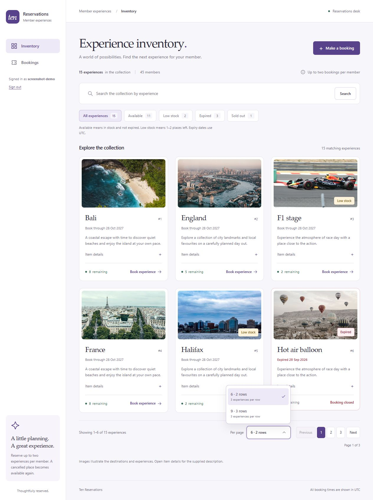
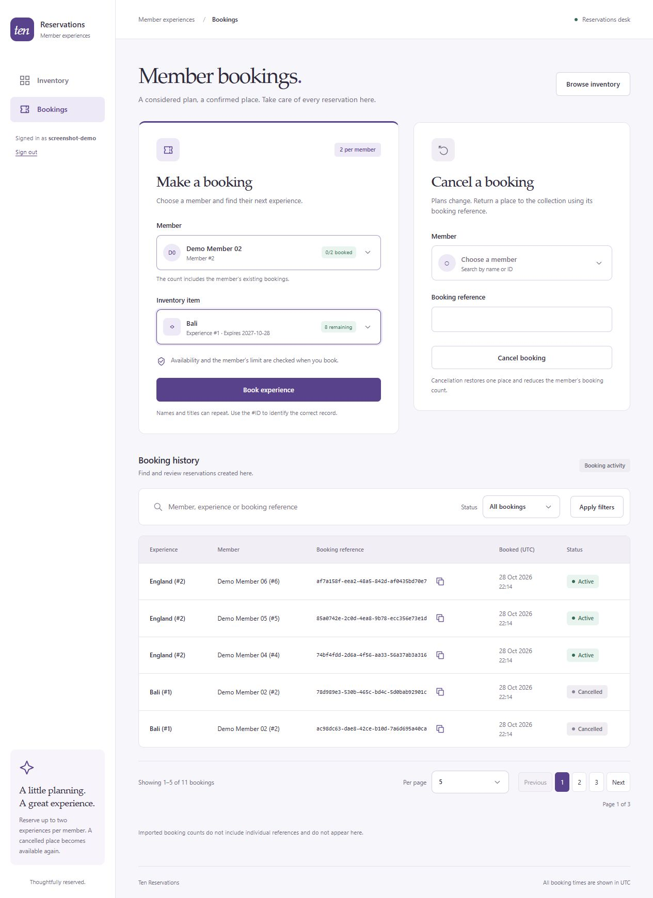
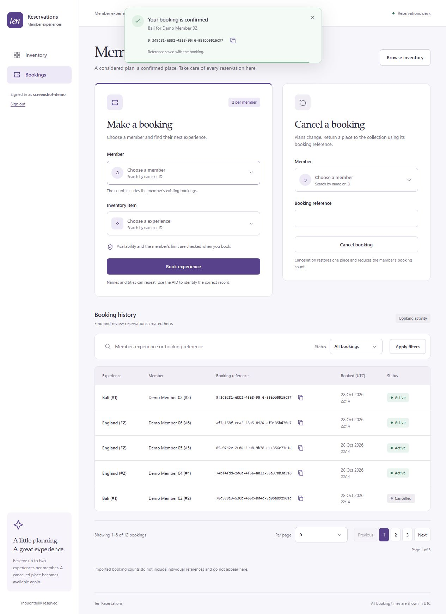
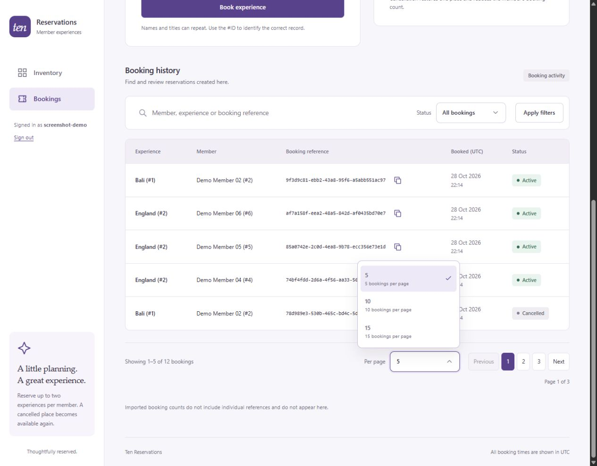
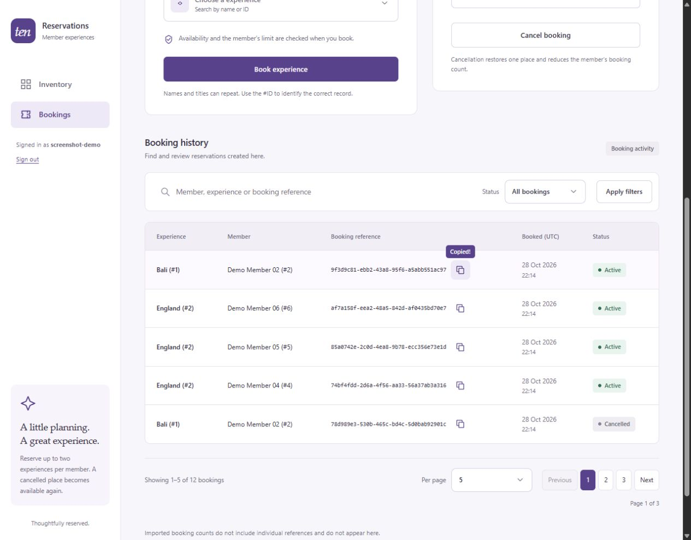
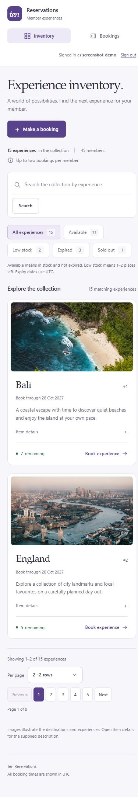

# Application screenshots

These screenshots show the Angular interface running locally against an **isolated synthetic dataset**. Member names, booking references, counts, and the signed-in demo account are demonstration values. No existing application database, real staff account, private notes, or credentials were used. They illustrate the application and do not establish that a hosted deployment is live.

## Experience inventory

Two complete rows on a three-column desktop layout, availability quick filters, stock badges, and expired experiences that cannot be booked. The Per page menu follows the grid's row capacity.

## Booking desk

Searchable member and experience selectors, a separate cancellation form, and filtered booking history with copy icons beside references.

## Booking confirmation

After a successful booking, the Member and Inventory item selections clear. A notification appears at the top center for five seconds, with a copy action and close button.

## History and page sizes

Booking history uses server-side filtering and pagination. Per page offers useful capacities of **5, 10, or 15**, with no exact-total All N choices. Successful clipboard writes show **Copied!** beside the icon for two seconds.

## Mobile inventory

The navigation becomes compact and cards stack into one column. Two rows means two cards per page; the three-row option offers three.

## Updating the gallery

1. Build the current Angular source and start a loopback-only Django preview using an isolated database and temporary staff account. Populate it with clearly synthetic member records, example experiences, and disposable bookings.
2. Capture the rendered application with browser screenshot tooling. Use desktop and mobile viewports; do not include browser chrome, credentials, or real member/account data.
3. Save captures as JPEG or PNG, matching their actual file format, under `docs/screenshots/`, inspect each image, and update these captions and alt text when behavior changes.
4. Close the preview, remove temporary credentials, verify the actual application database was untouched, and check the relative image links before committing.

The screenshots are illustrative. Dates and counts depend on the demo fixture and capture time. Photo attributions remain in [the image credits](bookings/static/bookings/images/ATTRIBUTIONS.md). Setup details are in [README.md](README.md), and contributor guidance is in [Agent.md](Agent.md).
